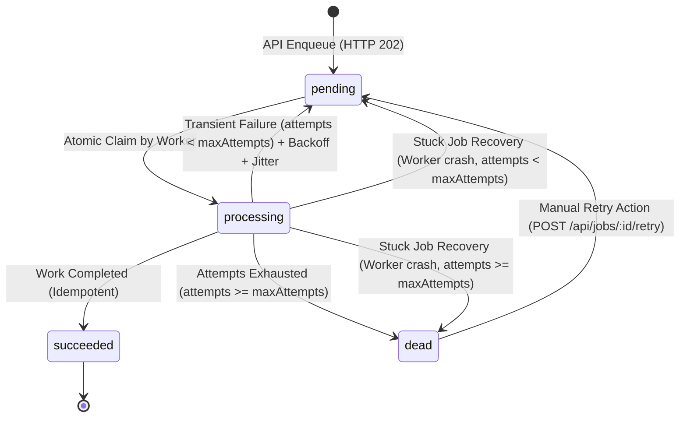

# JOELYN Background Jobs — System Architecture & Design

This document details the architectural design, database semantics, and execution model of the **JOELYN** Background Job Worker System.

---

## 1. System Architecture Overview

```text
  +--------------------+
  |   HTTP Client      |
  +---------+----------+
            | 1. POST /api/jobs (Payload + Idempotency-Key)
            v
  +--------------------+
  |     API Server     |  <--- Returns HTTP 202 Accepted (< 5ms)
  +---------+----------+       with { jobId, status: 'pending' }
            | 2. Atomic INSERT with UNIQUE(idempotency_key)
            v
  +--------------------------------------------------+
  |              SQLite Database (WAL Mode)          |
  |  Table: jobs (Indexed by status, run_at, etc.)   |
  +-------------------------+------------------------+
                            | 3. Atomic UPDATE RETURNING
                            |    WHERE status='pending' AND run_at <= now
                            v
  +--------------------------------------------------+
  |               Background Worker(s)               |
  |         (Configurable Concurrency Pool)          |
  +-------------------------+------------------------+
                            | 4. Executes Idempotent PDF Task
                            v
             +--------------+--------------+
             |                             |
     [Success Path]                 [Failure Path]
             |                             |
             v                             v
  Status -> 'succeeded'            Attempts < MaxAttempts?
  Sets finishedAt, result           /                 \
                                [YES]                 [NO]
                                  |                     |
                                  v                     v
                        Status -> 'pending'    Status -> 'dead'
                        Exponential Backoff    (DLQ - Manual Retry)
                        + Random Jitter
```

---

## 2. Full Job Lifecycle State Machine

The Job model enforces five distinct lifecycle states:



### State Definitions & Distinction
- **`pending`**: The job is stored in the database and waiting to be processed when `runAt <= current_timestamp`.
- **`processing`**: A worker has acquired the atomic lock and is executing the task.
- **`succeeded`**: The task finished successfully. Deterministic artifacts are saved and recorded.
- **`failed` (or pending with retry schedule)**: The attempt encountered an error, but remaining attempts exist. The job is scheduled for future re-execution.
- **`dead`**: The job has exhausted all allowed attempts ($attempts \ge maxAttempts$). The worker will **never** automatically execute it again.

> **Crucial Rule:** `failed` $\neq$ `dead`. A failed job is temporarily resting under exponential backoff; a dead job is permanently quarantined in the Dead-Letter Queue awaiting human inspection.

---

## 3. Atomic Job Claiming

To prevent race conditions where two workers concurrently claim the same pending job, JOELYN uses an atomic SQLite `UPDATE ... RETURNING` statement inside WAL (Write-Ahead Logging) mode:

```sql
UPDATE jobs
SET status = 'processing',
    started_at = :now,
    updated_at = :now
WHERE id = (
  SELECT id FROM jobs
  WHERE status = 'pending'
    AND run_at <= :now
  ORDER BY run_at ASC, created_at ASC
  LIMIT 1
)
RETURNING *;
```

### Why this guarantees safety:
1. SQLite transactions operate atomically. The write lock guarantees that only one worker can mutate the row.
2. The subquery identifies the oldest ready job and marks it `processing` in the exact same atomic transaction step.
3. The database engine returns the claimed record exclusively to the worker that secured the mutation.
4. Subsequent or concurrent queries by other workers will automatically skip the row since its status is no longer `pending`.

---

## 4. Idempotency Model

JOELYN distinguishes between two separate idempotency layers:

### A. Enqueue Idempotency (API Layer)
- Enforced via a database `UNIQUE INDEX` on `jobs.idempotency_key`.
- If a client resubmits the same request (due to network timeout or retry), the database rejects duplicate row creation.
- The API catches the constraint violation and returns the original job with HTTP 202.

### B. Work Idempotency (Execution Layer)
- If a worker crashes after generating the PDF report but before updating the database to `succeeded`, a replacement worker will later execute the job.
- The worker uses deterministic output identity: `storage/reports/report_{jobId}.pdf`.
- Before rendering, the worker checks if the output file already exists and is valid. If so, it reuses the generated asset and marks the job `succeeded` without redundant processing or corrupting files.

---

## 5. Retry Mechanics: Exponential Backoff & Jitter

### Mathematical Delay Formula:
$$\text{Exponential Delay} = \min\left(\text{BaseDelay} \times 2^{(\text{attempts}-1)}, \text{MaxDelay}\right)$$
$$\text{Jitter} = \text{random}\left(0, \text{JitterRatio} \times \text{Exponential Delay}\right)$$
$$\text{Total Retry Delay} = \text{Exponential Delay} + \text{Jitter}$$
$$\text{Next RunAt} = \text{Now} + \text{Total Retry Delay}$$

### Why Both Are Essential:
- **Exponential Backoff:** Prevents hammering overwhelmed downstream systems.
- **Random Jitter:** Prevents the **Thundering Herd** problem where multiple failed jobs wake up at the exact same millisecond and re-saturate dependencies.

---

## 6. Stuck Job Detection & Recovery

When a worker process crashes abruptly (e.g. `kill -9`, power loss, or uncaught native crash), a job might remain stuck in `status = 'processing'` indefinitely.

### Recovery Logic:
1. Periodic scanner runs every `RECOVERY_INTERVAL_MS`.
2. Queries for orphaned jobs:
   ```sql
   SELECT * FROM jobs
   WHERE status = 'processing'
     AND started_at <= (now - PROCESSING_TIMEOUT_MS)
   ```
3. For each stuck job:
   - Increments `attempts`.
   - If $attempts < maxAttempts$: Sets `status = 'pending'`, calculates exponential backoff + jitter for `runAt`, and logs a recovery warning.
   - If $attempts \ge maxAttempts$: Sets `status = 'dead'` with timeout explanation.

---

## 7. Dead-Letter Queue (DLQ) & Manual Retry

- **Quarantine:** Exhausted jobs are permanently moved to `dead` status.
- **Inspection:** Visible via `GET /api/jobs/dead` and the Web UI, displaying error stack, attempt count, payload, and timestamps.
- **Human Retry (`POST /api/jobs/:id/retry`):** Resets `status = 'pending'`, `attempts = 0`, `last_error = null`, and `runAt = now`. The job re-enters the active queue with a clean slate.
